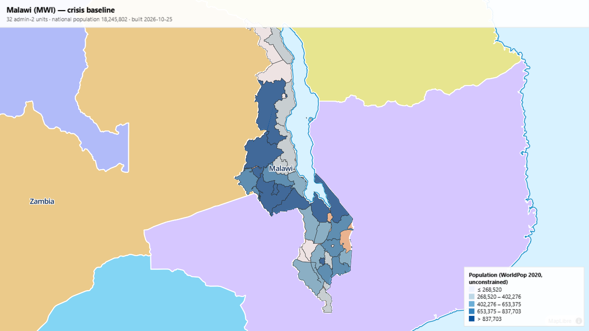

# Crisis Baseline Kit

[](https://github.com/alfredshingai/crisis-baseline-kit/actions/workflows/build.yml)
[](https://github.com/alfredshingai/crisis-baseline-kit/releases)
[](LICENSE)


> Type a country code, get a documented, crisis-ready baseline map and
> database — built entirely from public data, refreshed on a schedule,
> with provenance for every row.



*The bundled map viewer showing the v0.1 Malawi baseline: population per
admin-2 unit (WorldPop 2020) over OCHA COD-AB boundaries.*

## The problem

When a crisis hits, responders spend the first days assembling the same
layers from a dozen inconsistent sources: boundaries, population, roads,
facilities, exposure. That assembly work happens *during* the emergency,
under time pressure, and is repeated by every organization independently.

This kit makes it a finished, reproducible artifact **before** the
emergency. One command produces a versioned baseline — and anyone can
rebuild and verify it, because every layer carries its source URL,
license, version and checksum.

## Who it's for

- **Humanitarian responders & preparedness teams** — a ready-made situational
  baseline the moment something happens
- **GIS / data staff at NGOs and UN agencies** — the standard layers,
  harmonized, with p-codes, ready to join against your own data
- **Researchers & students** — clean, documented, citable subnational data
- **Open-data / OSM contributors** — a structure that turns public datasets
  into operational products

## Get the data (no code needed)

Ready-built bundles are published as
[GitHub Releases](https://github.com/alfredshingai/crisis-baseline-kit/releases) —
the [v0.1.0 Malawi baseline](https://github.com/alfredshingai/crisis-baseline-kit/releases/tag/v0.1.0)
includes GeoPackage, GeoParquet and GeoJSON downloads plus a map viewer,
quality report and full provenance manifest.

## Quickstart

```bash
python -m venv .venv && source .venv/bin/activate   # Windows: .venv\Scripts\activate
pip install -e .

cbk build MWI          # fetch sources, build the Malawi baseline bundle
cbk serve MWI          # open the bundled map viewer (http://127.0.0.1:8000)
cbk selftest           # synthetic end-to-end test, no network needed
cbk adapters           # list available source adapters
```

## What a build produces

```
baselines/MWI/2026-10-25/
├── cbk_baseline.gpkg    # admin 0/1/2 boundaries; admin 2 carries the stats
├── admin2.parquet       # admin-2 table (GeoParquet, analysis-ready)
├── admin2.geojson       # same table, used by the viewer
├── manifest.json        # per-layer source URL, license, version, SHA-256, timestamps
├── quality_report.json  # automated quality-gate results
├── index.html           # MapLibre choropleth viewer (no tile server needed)
├── README.md            # human-readable summary, auto-generated
├── data/                # normalized per-layer outputs
└── raw/                 # original downloads, checksummed
```

Every admin-2 row ends up with `population_sum`, `area_km2` and
`pop_density_km2` — the zonal-statistics join that turns a pile of
downloads into a database. A build whose quality gate fails (unexpected
admin-2 count, population total out of range, missing p-codes, ...) exits
non-zero, so broken baselines cannot ship silently.

## How it works

```
country profile (YAML) ──► adapters ──► pipeline ──► dated bundle + viewer
      MWI.yaml             codab        zonal stats    cbk_baseline.gpkg
                            worldpop    quality gate   manifest.json
                                        provenance     quality_report.json
```

- **Countries are YAML profiles** (`profiles/MWI.yaml`): sources, admin
  levels, expected quality ranges, viewer styling. Adding a country
  requires no code.
- **Sources are adapters**: one small Python module per source
  (`fetch → normalize → document provenance`). Everything downstream —
  joins, statistics, manifest, viewer, quality gates — is shared.
- **Quality gates block bad builds**: expectations live in the profile and
  run on every build, locally and in CI.
- **CI rebuilds continuously**: self-test on every PR; scheduled weekly
  rebuilds keep baselines fresh as sources update.

## Roadmap

- v0.2 — roads & buildings (OSM), health facilities, schools; PMTiles
  output; bundle diffing ("what changed since last month's baseline")
- v0.3 — hazard layers (JRC surface water, Copernicus DEM) and simple
  exposure scoring per admin unit
- growth — more countries (each one is a YAML file), a cross-country
  Parquet dataset for region-wide queries, cross-border regions
  (e.g. the Zambezi basin)

## Contributing

Issues and PRs welcome — see [CONTRIBUTING.md](CONTRIBUTING.md). Two great
ways to start: **adopt a country** (write a profile, run it, fix what
breaks) or **write an adapter** for a source you know. This project
follows the [Contributor Covenant](CODE_OF_CONDUCT.md).

## Citation

If the kit or its baselines help your work, please cite it — see
[CITATION.cff](CITATION.cff) (GitHub exposes a "Cite this repository"
button on the repo homepage).

## License

Code: MIT. Data: per-source licenses, recorded per layer in each bundle's
`manifest.json` — see [docs/sources.md](docs/sources.md) for the full
policy, including how ODbL (share-alike) OSM data will be handled from v0.2.
