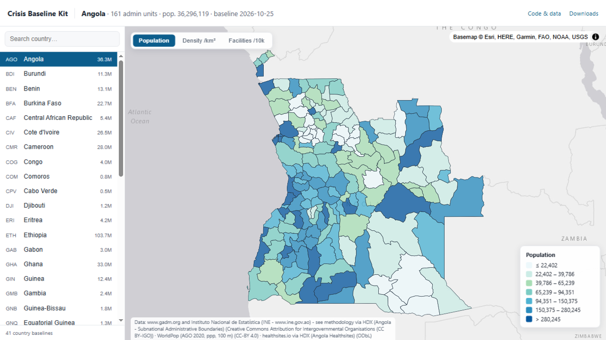

# Crisis Baseline Kit

[](https://github.com/alfredshingai/crisis-baseline-kit/actions/workflows/build.yml)
[](https://github.com/alfredshingai/crisis-baseline-kit/releases)
[](LICENSE)


> Type a country code, get a documented, crisis-ready baseline map and
> database — built entirely from public data, refreshed on a schedule,
> with provenance for every row.

**Africa-wide coverage: 50+ country baselines built from OCHA boundaries,
WorldPop population and healthsites.io facilities — see the
[live map](https://alfredshingai.dev/crisis-baseline-kit/).**



*The live map: population per admin unit (WorldPop 2020) over OCHA COD-AB
boundaries, with health-facility coverage per district. Switch countries,
fields, and click any unit for details.*

## The problem

When a crisis hits, responders spend the first days assembling the same
layers from a dozen inconsistent sources: boundaries, population, facilities.
That assembly happens *during* the emergency, under time pressure, repeated
by every organization independently.

This kit makes it a finished, reproducible artifact **before** the
emergency — for an entire continent, not just countries that already had
data teams.

## Get the data (no code needed)

- **Live map:** [alfredshingai.dev/crisis-baseline-kit](https://alfredshingai.dev/crisis-baseline-kit/)
  — all countries, searchable sidebar, population / density / facility
  fields.
- **Downloads:** [Releases](https://github.com/alfredshingai/crisis-baseline-kit/releases)
  carry full-resolution bundles per country: GeoPackage (all layers),
  GeoParquet (analysis-ready admin table + facility points), GeoJSON,
  provenance manifest, quality report, and the original raw source files.

## Coverage

Every African country is supported where sources allow. As of v0.3:

- **Boundaries (COD-AB):** 54/54 countries available on HDX; built for all
  but Mauritius (package ships only image files)
- **Population (WorldPop 2020, 100 m):** 55/55 countries
- **Health facilities (healthsites.io):** 52/55 countries (optional layer —
  builds skip it where the dataset is missing)
- **Admin depth:** admin-2 wherever the COD-AB has it (e.g. Nigeria's 774
  LGAs, Kenya's 290 units); deepest available level otherwise (São Tomé,
  Western Sahara at admin-1)

Each country has a quality gate: expected admin-unit count (pinned from a
verified build) and a population plausibility band (±40% of UN 2020
estimates; widened with justification where sources genuinely disagree,
e.g. South Sudan's post-2008-census uncertainty). **A build fails loudly
rather than shipping wrong numbers.**

## Quickstart

```bash
python -m venv .venv && source .venv/bin/activate   # Windows: .venv\Scripts\activate
pip install -e .

cbk build MWI          # build any country: ISO3 from profiles/
cbk build KEN --out baselines
cbk serve MWI          # open the bundled map viewer locally
cbk selftest           # synthetic end-to-end test, no network needed
cbk adapters           # list available source adapters
```

## What a build produces

```
baselines/MWI/2026-10-25/
├── cbk_baseline.gpkg    # admin boundaries + facilities; stats level carries the joins
├── admin2.parquet       # analysis-ready admin table (GeoParquet)
├── admin2.geojson       # same table for map viewers
├── facilities.parquet   # health facility points (separate ODbL table)
├── manifest.json        # per-layer source URL, license, version, SHA-256, timestamps
├── quality_report.json  # automated quality-gate results
├── index.html           # bundled map viewer (no tile server needed)
└── raw/                 # original downloads, checksummed
```

Admin units carry `population_sum`, `area_km2`, `pop_density_km2`,
`facility_count` and `facilities_per_10k_pop` — the zonal-statistics join
that turns a pile of downloads into a database.

## How it works

```
country profile (YAML) ──► adapters ──► pipeline ──► dated bundle + viewer
      MWI.yaml             codab        zonal stats    cbk_baseline.gpkg
                            worldpop    quality gate   manifest.json
                            healthsites provenance     quality_report.json
```

- **Countries are YAML profiles** — sources, admin levels, CRS, quality
  gates, viewer styling. All 54 profiles ship in `profiles/`.
- **Sources are adapters** — small modules that fetch, normalize, and
  document provenance. They handle the real world: multi-resource COD-AB
  packages, per-level zips, GeoPackages, ESRI geodatabases, EMF-only junk.
- **Quality gates block bad builds** — locally and in CI.
- **CI rebuilds weekly** — per-country parallel jobs, then the live map
  republishes automatically.

## Adding a data source

One module in `src/cbk/adapters/` implementing `run(ctx, params) ->
LayerResult` with complete provenance (license, URLs, version, retrieval
time). See [CONTRIBUTING.md](CONTRIBUTING.md). Good next adapters: OSM
roads/buildings (Geofabrik), schools (UNICEF × OSM), JRC surface water.

## Roadmap

- ~~health facilities~~ ✓ · ~~live map~~ ✓ · ~~Africa coverage~~ ✓ v0.3
- next — roads & buildings (OSM), schools; PMTiles output for faster maps;
  bundle diffing ("what changed since last month's baseline")
- v0.4 — hazard layers (JRC surface water, Copernicus DEM) and exposure
  scoring per admin unit (population in flood zones, distance to roads)
- growth — cross-country Parquet dataset for region-wide queries;
  cross-border basins (Zambezi, Lake Chad); other continents

## Contributing

Issues and PRs welcome — start with
[CONTRIBUTING.md](CONTRIBUTING.md). Especially useful right now:
adapter work (roads, schools), quality-check ideas, and testing builds
for your own country. This project follows the
[Contributor Covenant](CODE_OF_CONDUCT.md).

## Citation

See [CITATION.cff](CITATION.cff) — GitHub shows a "Cite this repository"
button on the repo homepage.

## License

Code: MIT. Data: per-source licenses, recorded per layer in each bundle's
`manifest.json` — WorldPop CC-BY 4.0, OCHA COD-AB CC BY-IGO, healthsites.io
ODbL (kept in a separate table; see
[docs/sources.md](docs/sources.md)).
